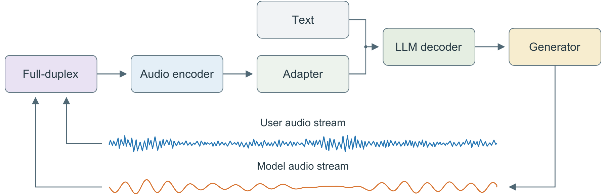
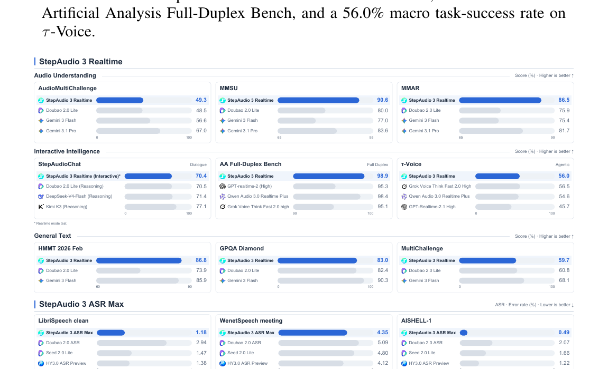

# StepAudio 3 Realtime

StepAudio 3 Realtime is an audio-language foundation model for fluid spoken interaction. It combines acoustic understanding, dialogue management, reasoning, spoken delivery, and tool execution in a continuous `listen-converse-think-act` loop.

## Public API

The currently available interface is the Chat Completions API:

```text
POST https://api.stepfun.com/v1/chat/completions
model: stepaudio-3-chat-preview
```

The public model ID is **`stepaudio-3-chat-preview`**. The Realtime WebSocket API is not documented in this release.

## Quickstart

Set an API key in the environment and pass a local audio file:

```bash
export STEPFUN_API_KEY="<your-step-api-key>"
bash examples/chat_no_system.sh ./audio.wav
```

The explicit-empty-system variant is available for clients that need a system message field:

```bash
export STEPFUN_API_KEY="<your-step-api-key>"
bash examples/chat_explicit_empty_system.sh ./audio.wav
```

Both examples use `temperature=0.7` and `max_tokens=32000`. Audio is sent as an `input_audio` content block with base64-encoded data. The scripts do not contain credentials.

## Benchmark Inference Examples

The [benchmark examples](./examples/README.md) provide one actual case for each of eight audio-understanding benchmarks, including prepared audio blocks, the full request structure, saved answer text, and an executable API runner. They distinguish Audio Multi-Challenge’s fixed-history/final-turn generation from MTalk-Bench’s sequential generation with text history.

```bash
# Inspect a benchmark-specific request without calling the API.
python3 examples/run_benchmark.py mmsu

# Run a complete multi-turn case with your own API key.
python3 examples/run_benchmark.py mtalk_bench --run --output-dir ./outputs/mtalk_bench
```

## Model

### Deep Perception

The model preserves both linguistic and non-verbal acoustic evidence, including vocal delivery, acoustic context, and turn-level cues. This allows a response to account for not only what was said but also how it was said.

### Seamless Duplex

User and model audio streams are modeled together so the interaction can handle pauses, backchannels, and interruptions. The conversational state can be updated while speech is being produced.

### Think-While-Speaking

Private reasoning can continue in parallel with spoken delivery. Adaptive Thinking selects when deliberate reasoning is useful, while multi-token prediction improves the efficiency of the reasoning path.

### Integrated Voice Agent

The model can carry conversational intent into asynchronous tool execution and incorporate returned results into the subsequent dialogue.

## Architecture



The audio encoder and adapter connect user audio to the language-model decoder. The generated model stream feeds back into the full-duplex context, allowing the system to maintain a shared state over user speech, model speech, text, and actions.

## Reported Results

The technical report reports the following headline results:

| Area | Benchmark | Result |
| --- | --- | ---: |
| Audio understanding | MMSU | 90.6 |
| Interactive intelligence | Artificial Analysis Full-Duplex Bench, Overall | 98.9 |
| Agentic interaction | τ-Voice, macro task success | 56.0% |
| Dialogue reasoning | StepAudioChat, reasoning mode macro average | 73.0 |



The benchmark figure and the detailed protocols are from the [StepAudio 3 Realtime Technical Report](https://arxiv.org/abs/2609.14005).

## Evaluation Configuration

The public evaluation configuration used for the audio-understanding results is documented in [EVALUATION.md](./EVALUATION.md). In summary, the Chat Completions requests use:

| Parameter | Value |
| --- | --- |
| Endpoint | `https://api.stepfun.com/v1/chat/completions` |
| Model | `stepaudio-3-chat-preview` |
| Temperature | `0.7` |
| Max tokens | `32000` |
| System message | omitted in the main setting |

The benchmark-specific request construction and evaluation methods are documented in the same file. Results that require a language-model evaluator use text-only LLM judges.

## Resources

- [StepAudio 3 Realtime Technical Report](https://arxiv.org/abs/2609.14005)
- [Realtime model documentation](https://platform.stepfun.com/docs/zh/guides/models/stepaudio-3-realtime)
- [Chat Completions API](https://platform.stepfun.com/docs/zh/api-reference/chat/chat-completion-create)
- [Realtime API](https://platform.stepfun.com/docs/zh/api-reference/realtime/chat)
- [Realtime Console](https://github.com/stepfun-ai/Step-Realtime-Console)
- [Audio experience center](https://www.stepfun.com/studio/audio?tab=voice-chat)

## Files

- [`examples/README.md`](./examples/README.md): eight benchmark-specific case examples and request construction.
- [`examples/run_benchmark.py`](./examples/run_benchmark.py): inspect requests or run bundled cases with the public API.
- [`examples/chat_no_system.sh`](./examples/chat_no_system.sh): request without a system message.
- [`examples/chat_explicit_empty_system.sh`](./examples/chat_explicit_empty_system.sh): request with an explicitly empty system message.
- [`configs/`](./configs/): equivalent YAML request settings.
- [`EVALUATION.md`](./EVALUATION.md): public benchmark request and scoring configuration.
